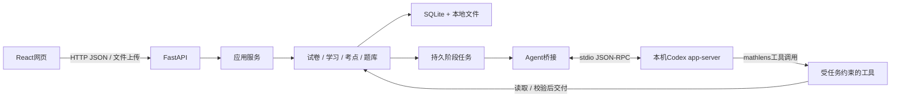

# 项目架构与后端分层

主服务使用FastAPI/Uvicorn，同源提供React页面和API；SQLite保存记录，本地文件保存PDF、题图、照片和固定材料。框架迁移、基础分包已经完成，任务、工具、桥接和存储职责仍有混合。

本文件是项目框架、通信和模块边界的维护入口；当前能力见[项目说明](../README.md)，Agent字段/契约只见[Agent协议](agent-workflow.md)，任务状态只在本机TODO维护。

## 整体框架

| 部分 | 实际实现 |
| --- | --- |
| Web | React 19、TypeScript、Vite 7；CSS Modules与CSS变量，KaTeX随构建离线打包；React Router 7导航，TanStack Query按资源获取与失效；细节见[前端设计](frontend-design.md) |
| HTTP后端 | FastAPI、Pydantic请求校验、Uvicorn服务进程；AppConfig显式路径配置，AppRuntime持有服务，通过FastAPI依赖注入供路由调用 |
| 业务/存储 | Python领域模块、SQLite直接SQL、本地文件；没有ORM、Redis或独立消息队列服务 |
| PDF/OCR | PyMuPDF提取/裁切，RapidOCR/ONNX辅助扫描件定位，Pillow处理照片；数学理解交学习Agent |
| Agent | 本机Codex登录账户、codex app-server、stdio JSON-RPC、每任务一个新会话；模型推理由Codex调用设置中所选模型完成 |
| 验证 | Python unittest隔离测试、Node内置测试；旧真实模型实验脚本已归档，按改动选择检查 |

```text
项目根目录
├── app/                  Python后端
├── web/                  前端源码与Vite开发配置
├── dist/                 构建后的前端，由FastAPI提供
├── .agents/skills/       学习Agent的任务方法与交付说明
├── scripts/              仍使用的CLI/资料工具，archive仅存历史文本
├── tests/                有效自动测试，archive不参与执行
├── docs/                 当前文档及历史归档
├── .mathlens/            旧版资料备份，迁移后保留（Git忽略）
└── setup/start_*.bat/ps1  安装与一键启动
```

根目录的18个旧Python兼容文件已移除。应用、活动scripts与测试均直接使用app包；测试路径辅助函数仅在tests/database_fixture.py中维护。

## 通信和执行



正常使用时，Vite将前端构建到dist，FastAPI在同一地址提供页面、`/api/*`及图片/PDF资源。浏览器通过fetch发送JSON，上传PDF/照片使用multipart；不连接SQLite或直接启动Codex。开发模式由Vite提供页面，其`/api`代理读取本地服务的实际地址，配置见web/vite.config.ts。

当前同步使用HTTP轮询：工作区约每3秒读取bootstrap，Agent约每1秒读取state，识别进度约每1.2秒读取preparation；任务完成后重新读取保存结果。bootstrap结果按个人库、通用库各自的`PRAGMA data_version`缓存（app/services/workspace.py，常驻只读观察连接），任一库有提交即重建，构建期间发生提交则不缓存；测量入口为scripts/benchmark_bootstrap.py，阶段耗时汇总为scripts/stage_timings.py。新前端将改为按资源读取和SSE推送，接口见前端重构计划。

Agent参与过程：

1. 用户上传/点击分析、选题或提交作答，后端先保存材料或作答，再排入持久阶段任务。上传照片本身不批改。
2. 调度器为每个任务启动本机`codex app-server --listen stdio://`并新建一个会话（thread/start），按任务档位设置模型与推理强度（app/agent/models.py），交付或失败后关闭本次执行；bridge只持有当前一次执行，会话ID只作记录。执行进程与会话使用工作区下的agent-runtime目录（内含由模板生成的AGENTS.md）并以只读沙箱运行（规则见[Agent协议](agent-workflow.md#执行入口与会话)）。登录和模型调用由Codex负责，不要求网页填写模型API URL。
3. 任务创建时捕获明确的试卷/作答范围、材料版本、schema和写入身份。app/agent/material_package.py把任务头与所需材料组装为初始输入，并为实际提供的材料生成阅读回执；选题候选由app/learning/selection.py按规范原子召回、排除和排序，Agent只判断适配并选择。需补看时通过动态mathlens工具读取。
4. Agent按固定JSON契约交付，直接deliver_result（preflight仅调试用，与保存同一套校验后回滚）。后端校验身份、材料/引用及结构，在同一事务内保存结果、业务投影和回执；标注任务同时发布出处。模型聊天文字不自动成为报告，Agent不直接修改用户数据库。
5. 保存回执写入即任务完成，应用派发下一阶段；重启或断线时有回执直接完成，无回执失败、重试新建会话。单题复核的逐题语义依赖（正误、首错、考点）由app/learning/semantic_dependencies.py比较并写入record_versions，不改写历史输入和散列。网页展示已保存的逐题分析/练习/反馈及必要进度，不展示内部思考或要求用户维护JSON。

学习session由应用独占使用；Desktop/CLI接管需先释放，不能两个客户端同时控制。CLI/MCP入口及具体阶段、工具参数见[Agent协议](agent-workflow.md)。

## 模块职责

| 位置 | 职责 |
| --- | --- |
| app/main.py、runtime.py、config.py | 应用工厂、显式配置、服务组装和生命周期 |
| app/__main__.py、cli.py、hosting.py、version.py | 包启动、Uvicorn/端口与地址登记、统一版本 |
| app/api/ | HTTP输入、响应与请求边界；router.py登记业务路由，errors.py处理错误，frontend.py提供前端静态资源 |
| app/services/ | 试卷、作答、题库和知识的应用用例 |
| app/learning/ | 任务契约、捕获输入、交付/回执、学习记录和阶段队列 |
| app/agent/ | 单任务执行、模型档位与列表、初始材料包、模型进程通信、工具读取 |
| app/knowledge/ | 统一目录、发布/重定向、资料准备、证据映射与画像 |
| app/bank/ | 题目材料、身份、标注、访问/曝光与程序召回 |
| app/documents/ | PDF/OCR、切题与识别进度 |
| app/storage/ | 数据库、文件材料、共享资料、备份恢复及只读快照 |

默认入口是`python -m app`，BAT也走这一入口。main.py只组装服务生命周期、HTTP边界和路由；路由调用services，服务组织领域操作和存储。配置由AppConfig传入，AppRuntime持有每个应用实例的数据库与服务；请求经依赖注入取用。

旧的标准库HTTP主服务绑定器及根目录兼容壳均已移除，手动命令也使用包入口。领域内部尚未完全满足分层，集中点见末节。

## 数据归属与存储

通用资料与个人工作区已物理拆分：独立SQLite文件、独立资源目录。Windows默认位于`%LOCALAPPDATA%/ZuoTiLong/`，不再将运行数据放进源码/发行目录：

```text
ZuoTiLong/
├── library/
│   ├── library.db                 通用考点、题库、标注及核验出处
│   ├── bank-assets/               干净题干、答案、参考解析
│   └── knowledge-sources/         通用目录依据
└── workspaces/default/
    ├── learning.db                试卷、练习、作答、批改、画像与设置
    ├── agent-session.db           本人的会话与执行状态投影
    ├── workspace.json             本工作区数据库名称及通用库位置
    └── papers/、answer-images/等   个人材料、固定快照、草稿、记忆、日志及备份
```

两个业务库之外，agent-session.db仍是工作区私有的执行投影。`MATHLENS_DATA_DIR`指定工作区；`MATHLENS_LIBRARY_DIR`指定通用资料目录。新工作区首次创建时学习记录为空，可指定已有通用库，无需重新标注。仅指定自定义工作区且尚无位置记录时，默认使用该目录内独立的library子目录，避免隐式连到其他工作区的资料。

| 归属 | 主要数据与存储 |
| --- | --- |
| 通用目录 | knowledge_catalog_*、knowledge_source_*、knowledge_nodes及目录包/来源表 |
| 通用题目 | bank_collections（题集）、bank_questions（每题一个collection_id）、bank_resources、bank_identity、bank_links、同题审核、导航校正及navigation_changes变更计数 |
| 通用标注 | question_annotations、question_annotation_links、question_annotation_topics、annotation_provenance及共享索引表 |
| 个人原卷 | papers、questions、agent_reports、question_diagnoses、paper_question_bindings |
| 个人练习 | diagnostic_probes、practice_goals、计划成员/关联表、probe_attempts、固定材料绑定、批改与解答修订历史 |
| 个人自由练习 | free_practice_attempts（题库单题作答，request_id唯一，每次作答冻结题面/参考/标注/定义快照于practice-materials，个人备份包含、闲置上传清理保留其照片）；聚合为独立来源free_practice，同步整题判定不扩散为各考点证据，只有AI批改明确指出且属于冻结标注的topic_ids影响原子状态，可由preferences.include_free_practice排除 |
| 个人证据与设置 | learning_events、knowledge_mappings、knowledge_mapping_versions、preferences、bank_views、bank_exposures、bank_cross_reviews；画像为只读聚合 |
| 本机执行 | learning_tasks、learning_results、task_reads、workflow_jobs、knowledge_preparation_*、tool_audit、record_versions；包含通用维护任务的执行日志，也只保存在工作区 |

默认学习连接以工作区为main，附加只读library数据库，现有跨域查询仍可关联；ATTACH不合并物理文件。只有题库/目录导入和维护入口显式申请通用库写权限。所属表集合集中在app/storage/boundaries.py，数据库组装、迁移分别在database.py和split.py。工作区的navigation-index.db是可删除、可重建的导航派生缓存，不含学习证据，也不进个人备份；不是第三份业务库。

目录描述数学知识，通用标注描述题目；个人记录描述本次作答、安排与长期表现。个人错因、练习回答范围、总结、知识证据映射、曝光、预留、备考类别和自定义笔迹约定均留在工作区。普通学习不把个人分析提升为通用标注，也不把用户卷面裁切写入公共题图。

个人记录以稳定ID、版本和固定材料引用通用资料；跨文件关系由服务校验，各文件保留域内外键。作答与批改排队仍在个人库同一事务中保存。维护交付通过附加数据库事务保存两侧结果；标注在本地交付事务成功时原子发布可复用核验出处。通用库不携带学习任务或会话；annotation_provenance按出处格式v2自包含保存题目材料/身份、输入摘要、实际材料与定义读取（含当时公开定义快照）及结果散列，导出、核验和修订基线只读通用库，不再回查原维护工作区；v2之前的历史标注用`scripts/backfill_annotation_provenance.py --library <库> --workspace <旧维护工作区>`先`--dry-run`再`--confirm <plan_sha256>`补齐（确认前自动做题库备份）。维护执行票据、工具日志和原任务输入保留在原工作区，仅作历史追溯。

首次默认启动会将旧项目.mathlens混合库复制迁移，分域创建新文件，成功后启用新目录；原目录保留供回切。迁移不重新解题、标注或制造学习事件。自定义工作区不自动导入旧个人记录。个人备份（设置页“立即备份”，保留3份）只含工作区，另记通用库的稳定library_id与单调revision（library_state表，各业务表写入由触发器递增）；恢复时同库且当前不旧于备份直接允许，当前更旧需显式确认，异库或缺库拒绝。通用库备份由`scripts/backup_library.py`单独执行，存ZuoTiLongData\backups，保留5份。个人备份含个人内容，不能作为发行包。

发行包应由代码、前端产物及允许分发的通用资料按允许项清单构建，不能复制个人目录再删表。物理隔离和空工作区已实现，专门的发行产物构建仍待做。通用资料也需遵守[题源目录](question-sources.md)中的使用边界，第三方教材/题库正文不自动进入Git或发行内容。

## 任务与材料

任务创建时捕获范围、材料和契约版本；保存校验与结果/投影/回执在同一事务内完成。明确提交作答与排入批改也在同一事务。本地保存回执即完成依据，不能用聊天结束替代回执。

原卷参考由paper_question_bindings关联；练习由practice_question_bindings和practice_attempt_materials关联固定材料。app/storage/practice_materials.py保存材料，app/agent/practice_materials.py按当前任务读取。题库更新不替换已布置题，已有真实作答和在途任务按原身份/版本处理。题面文字搜索（GET /api/bank?q）沿题干文本扫描，先应用题集/类别/考点筛选，再按与单题access一致的同题、身份、预留、遮挡策略批量过滤，不建持久FTS。questions.id只是内部主键、不编码题号；切题、重新识别和报告补建题号时用app/storage/question_ids.py的available_question_id避开已占用ID。

原卷切分纠正与拆分只用本地数据：拆分按切线划分region，题干按该PDF散列对应的pipeline缓存中带bbox的OCR行归属上下，不重跑OCR，与版本记录、重匹配同一事务。analyze_paper交付保留已有本地regions，Agent区域只填补无区域题；误被覆盖的旧数据由scripts/restore_segmentation_regions.py从同一缓存重算（预演/确认码，确认前SQLite backup API自动备份learning.db，写record_versions）。工具结果统一由tool_response生成多模态返回；最后一次拒绝原因持久化到task/job error，非校验异常记堆栈并停止任务。任务摘要中，同卷同kind之后已有completed任务的旧失败只从待处理投影隐藏。自由练习无历史时GET读当前材料投影，首次提交才冻结。

题集包与勘误（app/bank/collection_packs.py、errata.py，CLI export-collection/import-collection/apply-errata、import-source --errata）：导出当前标准记录、按SHA去重的资源、勘误、完整所需目录包和v2共享标注索引，不含个人数据或本机任务回执。导入用内存主库ATTACH通用库单事务写入，不连接个人learning.db；确认前自动题库备份，借用维护写围栏暂停其他写入但不长持bridge.lock。勘误生成新材料版本并保留original与历史，依赖旧材料的标注自然失效；固定练习材料不受影响。

共享目录和标注分别通过app/knowledge/packages.py、app/bank/annotation_packages.py处理；外部索引有独立出处，不伪造本机任务、阅读凭据或学生表现。停用影响后续准入，原练习仍沿固定材料。

具体版本、工具参数和维护操作只见[Agent协议](agent-workflow.md)与对应schema。

## 双向关联与只读画像

app/services/knowledge_links.py统一处理题目正查、考点反查、子树去重和完成判定。复用annotations.current的有效性判断，不调用Agent补标签。

app/storage/navigation_index.py把逐题校验后的导航、材料清单和定义依赖持久化在工作区navigation-index.db；通用库navigation_changes触发器只累计实际变更，题目/资源/标注变化只复核该题及同题组，目录变化先比较依赖，个人记录写入只刷新个人表现。服务启动时先完成首次或增量索引升级再提供页面（首次升级约半分钟，可先运行scripts/build_navigation_index.py预构建），之后考点读取不再整库复制和校验。app/storage/knowledge_reads.py只复制必要个人表；navigation_revision用于避免页面混用不同版本的统计与列表。题卡标签批量读取只按请求的题从持久索引取。选题创建与交付分两阶段：先在只读快照内捕获候选、校验并规范化（同一次捕获内复用已验证的标注与材料），再开短写事务核对两库data_version后写入，数据变化即拒绝重试；期间不持有bridge执行锁，HTTP读与retry/cancel不等待候选计算。

关联API只返回标签、角色、出处和状态，不回传解法或记录曝光。题库浏览与Agent选题使用不同过滤规则，个人完成数不等于题库数量或掌握状态。旧的/api/profile是环节汇总，不是规范考点树；退役前需核消费者。

## 已知职责集中点

- app/learning/tasks.py同时承担输入捕获、任务交付和计划保存。
- app/agent/tools.py集中多类action及结果组装；bridge.py集中连接、提示和事件协调。
- bank/knowledge的部分读取凭据依赖learning.tasks，数据库初始化也调用领域初始化。
- 部分服务仍有内部commit和文件写入交织；同步OCR占用学习写入锁，bootstrap仍定时整包读取。
- 包入口、脚本和测试导入已统一；测试夹具保留原有隔离路径用法，不参与生产服务组装。

修改相关模块时按实际调用拆分，保持已使用行为；这些问题不自动成为其他功能的前置条件。重构顺序见TODO，验证范围见[开发验收](full-loop-test-checklist.md)。

测试文件和历史验证脚本的归属只见[测试目录](../tests/README.md)。本文件不另列每项测试或发布流水。
